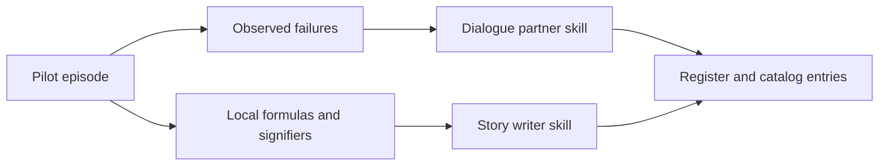

# Add a Market

The generic skills already produce micro-dramas for any market. Add a market pack
when a market will be produced repeatedly and deserves local depth.

## Start without a pack

1. Write the market card with `microdrama-story-formats` (see its market
   adaptation reference): language and register, names and address, class markers,
   settings, wardrobe, rituals, proof objects, taboos.
2. Check the dialogue language with `seedance-prompt-25-dialogue`. Record the
   route (native, annotation, supported-language dub with subtitles, audio-first).
3. Produce a pilot episode with `micro-drama` and record what the model got wrong.

## Promote to a pack

| Piece | Name pattern | Copy from |
| --- | --- | --- |
| Story writer | `<market>-micro-drama` | `filipino-micro-drama` |
| Dialogue partner | `seedance-prompt-25-<language>` | `seedance-prompt-25-filipino` |

## Checklist

- Each skill is independent: mention siblings in prose only.
- No personal paths, no real brands or people, no secrets.
- `SKILL.md`, `agents/openai.yaml`, `evals/evals.json`, concise references.
- Add a `.claude/skills/<name>` relative symlink into `.agents/skills/<name>`.
- Add the skill to `skills-lock.json` and `.agents/catalog/skills.json`, then run
  the catalog sync with `--refresh-integrity` and review the diff before writing.
- Add routing rows in `film-production` and `prompt-review` only if the pack needs
  a dedicated checklist.
